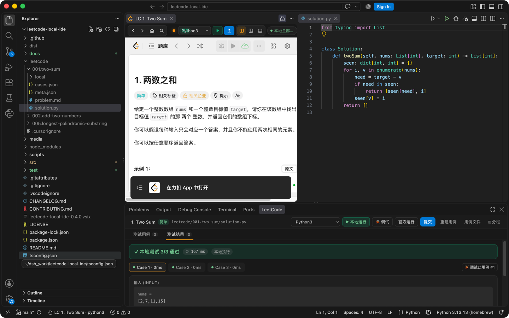
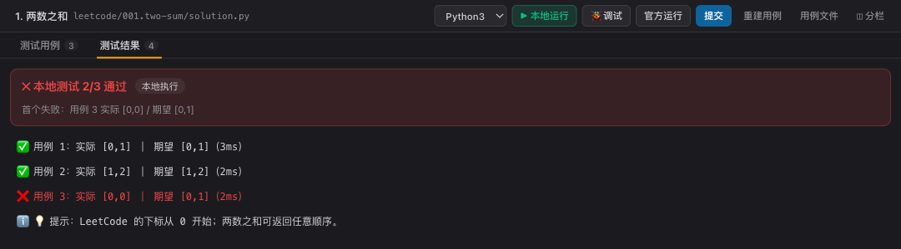

<div align="center">


# LeetCode Dojo

### 在 VS Code / Cursor 里刷 LeetCode —— 左边题面，右边本地 IDE

**本地跑测试 · 断点调试 · 官方判题提交 · AI 只提示不代写**

[](CHANGELOG.md)
[](https://code.visualstudio.com/)
[](https://cursor.com/)
[](LICENSE)

[⬇️ 安装](#安装) · [✨ 功能](#功能速览) · [🚀 三分钟上手](#三分钟上手) · [🤖 AI 限制](#ai-补全限制) · [❓ 常见问题](#常见问题)



<sub>左栏只剩题面 · 右栏是本地 <code>solution.py</code> · 底部是「本地测试 3/3 通过」</sub>

</div>

---

## 为什么用它

刷题最烦的三件事，它都处理掉了：

| 痛点 | 以前 | 现在 |
|---|---|---|
| **在网页编辑器里写代码** | 复制到本地改完再粘回去，来回折腾 | 直接在右栏用真实文件写，保存即同步 |
| **本地没有判题** | 只能提交才知道对不对 | 底部面板逐用例对比实际值 / 期望值，毫秒级反馈 |
| **断点调试无从下手** | 网页里只能 `print` | 本地调试器直接停在你写的 `solution.py` 里 |
| **AI 一句话把整题写完** | 抄完就忘，等于没练 | 补全被限制在「API 提示 / 单行」，思路还得自己想 |

---

## 功能速览

| | 功能 | 说明 |
|:--:|---|---|
| 🖥 | **题面 + IDE 同屏** | 左栏是真实的 LeetCode 页面，点题目右栏自动出现对应文件和官方类框架 |
| ✂️ | **只显示题面** | 线上编辑器自动隐藏；一键可切回完整网页（用站点自己的按钮） |
| 🌐 | **栏内登录，不用反复登** | 登录态保存在系统钥匙串，重开 IDE 自动回到上次那道题 |
| 🧪 | **本地跑测试** | 用例来自官方示例输入 + 题面输出解析，逐条对比并给出耗时 |
| 🐞 | **断点调试** | 可选某个用例或手写自定义输入，断点、变量、单步都可用 |
| 📤 | **官方运行 / 提交** | 走 LeetCode 自己的判题机，结果显示在底部面板 |
| 🔀 | **20 种语言随时切换** | Python / C++ / Java / Go / Rust / JS / TS / C / Ruby … 自动切文件与模板 |
| 📚 | **从任何入口进题** | 题库、学习计划（面试经典 150 等）、每日一题、竞赛题单都能点进来 |
| 🤖 | **AI 只提示不代写** | 三档强度：关闭 / 只提示 API 签名 / 允许补一行；同时压制 Copilot、Cursor Tab |
| 🧭 | **自动分栏** | 左题面 / 右代码 / 底测试台，被打乱会自动归位 |

---

## 界面速览

<table>
<tr>
<td width="50%"><br/>
<sub><b>左栏 · 只剩题面</b><br/>线上编辑器已隐藏，题目描述 / 题解 / 提交记录 一键切换</sub></td>
<td width="50%"><br/>
<sub><b>底部 · 测试用例</b><br/>输入与期望输出一目了然，每条都能单独调试，也可手改</sub></td>
</tr>
<tr>
<td colspan="2"><br/>
<sub><b>底部 · 测试结果</b><br/>逐用例 ✅ / ❌、实际值 vs 期望值、耗时与你的 <code>print</code> 输出</sub></td>
</tr>
</table>

---

## 安装

### ① 安装插件

```bash
# VS Code
code --install-extension leetcode-local-ide-0.4.1.vsix

# Cursor
cursor --install-extension leetcode-local-ide-0.4.1.vsix
```

> 也可以在 `扩展` 面板右上 `…` → `从 VSIX 安装…`。安装后**重载窗口**。
> 扩展 ID 是 `xialc.leetcode-local-ide`，显示名为 **LeetCode Dojo**。

<details>
<summary><b>没有 vsix？从源码构建</b></summary>

```bash
git clone https://github.com/captainedV/leetcode-dojo.git
cd leetcode-dojo
npm ci && npm run package
code --install-extension leetcode-local-ide-0.4.1.vsix
```
</details>

### ② 准备语言环境（只影响「本地运行 / 调试」）

只装你要用的语言就行，官方运行 / 提交不受影响。

| 语言 | 需要 | macOS 一键安装 |
|---|---|---|
| Python 3 | **Python ≥ 3.10**（模板里有 `ListNode \| None` 这类写法） | `brew install python` |
| C / C++ | clang / gcc | `xcode-select --install` |
| Java | JDK 17+ | `brew install openjdk` |
| JavaScript / TypeScript | Node.js ≥ 20 | `brew install node` |
| Go | Go 1.20+ | `brew install go` |
| Rust | rustc | `curl --proto '=https' --tlsv1.2 -sSf https://sh.rustup.rs \| sh` |
| Ruby | ruby | macOS 自带 |

**调试**还需要对应的调试器插件（都可在扩展市场搜索到）：

| 语言 | 插件 |
|---|---|
| Python | `Python Debugger`（或 `Python`） |
| C / C++ | `C/C++`（或 `CodeLLDB`） |
| JavaScript / TypeScript | 内置，无需安装 |
| Java / Go / Rust | `Extension Pack for Java` / `Go` / `CodeLLDB` |

### ③ 确认 IDE 能调用到你的环境

GUI 启动的编辑器有时拿不到你 shell 里的 `PATH`（Homebrew、nvm 都不在里面）。进题目后执行一次：

> **命令面板** → `LeetCode Dojo: 显示诊断信息`

看到 `langToolchain(python3)=齐全` 就说明可以跑了；如果显示缺少，会直接告诉你该装什么。

自动挑的 Python 版本不合适？在设置里指定：

```jsonc
{ "lcLocal.python.path": "/opt/homebrew/bin/python3.13" }
```

---

## 三分钟上手

**1. 进入模式**
点左下角状态栏 **`LeetCode`**，或在命令面板执行 `LeetCode Dojo: 进入 LeetCode 模式`。

**2. 登录**
左栏就是 LeetCode 网站，直接在里面登录。登录一次就够了，下次打开自动进入。

**3. 点一道题**
从题库、**学习计划**或每日一题点进去 —— 右栏会自动创建并打开本地文件，已填好官方类框架。

**4. 写代码**
在右侧本地文件里写，`⌘S` 保存即同步到网页；点网页自己的「运行 / 提交」也会用你本地的代码。

**5. 跑一下 / 交上去**

| 操作 | 快捷键（macOS） | 结果在哪看 |
|---|---|---|
| 本地运行测试 | <kbd>⌘</kbd><kbd>⌥</kbd><kbd>Enter</kbd> | 底部面板「测试结果」 |
| 提交到 LeetCode | <kbd>⌘</kbd><kbd>⌥</kbd><kbd>S</kbd> | 底部面板 + 弹窗 |
| 获取提示 | <kbd>⌘</kbd><kbd>⌥</kbd><kbd>H</kbd> | 输出面板 |

> Windows / Linux 把 <kbd>⌘</kbd> 换成 <kbd>Ctrl</kbd> 即可。

---

## 常用功能

<details>
<summary><b>🧪 本地测试用的是什么用例？</b></summary>

优先用题目官方的示例输入，配上从题面解析出的期望输出（所以结果和网页上的「示例」一致）。
可以在题目目录的 `cases.json` 里自己加用例，下次运行就会带上。

没通过时，底部面板会逐条显示：

```
❌ 本地测试 2/3 通过
  ✅ 用例 1：实际 [0,1] ｜ 期望 [0,1]（3ms）
  ✅ 用例 2：实际 [1,2] ｜ 期望 [1,2]（2ms）
  ❌ 用例 3：实际 [0,0] ｜ 期望 [0,1]（2ms）
  💡 提示：LeetCode 的下标从 0 开始；两数之和可返回任意顺序。
```
</details>

<details>
<summary><b>🐞 怎么调试？能自己输入测试数据吗？</b></summary>

点「调试」会让你选用例：

- **全部用例** —— 从头跑一遍
- **某个用例** —— 只跑这一条（底部「测试用例」里每条右侧也有「调试」按钮）
- **自定义输入** —— 直接写 `nums = [3,3], target = 6`，或每行一个参数

只调试单条用例时，异常会照常抛出来，**调试器会停在出错的那一行**。
</details>

<details>
<summary><b>📤 官方运行 / 提交失败怎么办？</b></summary>

- 先在左栏网页里确认已登录（状态条会显示「已登录：用户名」）
- 失败提示里通常写清了原因（未登录 / 频率限制 / 编译错误）
- 也可以直接点网页上 LeetCode 自己的「运行 / 提交」按钮 —— 用的是你本地代码
</details>

<details>
<summary><b>🌐 能不能换成 leetcode.com？</b></summary>

`leetcode.com` 由 Cloudflare 保护，无法在 IDE 内嵌网页。想用它可以在 `lcLocal.site` 里切换，然后手动粘贴登录 Cookie，走 API 模式（本地测试 / 运行 / 提交仍然可用）。
日常使用建议 `leetcode.cn`（默认）。
</details>

<details>
<summary><b>🧭 勾错了分栏 / 面板被关掉了</b></summary>

- 分栏乱了：命令 `LeetCode Dojo: 重置左右分栏布局`
- 底部面板没了：左栏工具栏点 `面板`，或命令 `LeetCode Dojo: 打开底部面板`
- 想看完整网页（含线上编辑器）：左栏工具栏点 `只显示题面` 切回
</details>

---

## AI 补全限制

刷题的人需要的不是"把答案写出来"，而是"想不起某个 API 时提醒我一下"。所以设了三档：

| 档位 | 你会得到 | 需要 API Key |
|---|---|---|
| `off` | 本插件不提供任何补全 | 否 |
| `signature`（默认） | 只提示**你正在调用的那个 API** 的名字与参数（内置 274 条刷题高频 API） | 否 |
| `line` | 允许补**当前这一行**，不会补出一整段算法 | 是 |

```python
# ✅ 会这样提示（API 用法）
nums.sort(key=lambda x: -x)     # 想不起参数名时，会补出 key=lambda …
heapq.heappush(h, (dist, node)) # 想不起参数顺序时，会补出 (h, item)

# ❌ 不会这样（替你写完整个解法）
# for i in range(len(nums)):
#     for j in range(i + 1, len(nums)):
#         if nums[i] + nums[j] == target: ...
```

同时，进入练习模式会自动：

- 关闭 `GitHub Copilot` 的行内补全（写在工作区设置里，退出时还原）
- 尽量关闭 Cursor 已知的 Tab 补全项，并把题目目录写进 `.cursorignore`

> ⚠️ Cursor 的 Tab 补全没有官方的工作区级开关，**需要你在 Cursor 设置里手动关一次**才能彻底静音。

<details>
<summary><b>怎么配置 / 想用自己的模型</b></summary>

```jsonc
{
  "lcLocal.hint.level": "signature",                    // off | signature | line
  "lcLocal.ai.enabled": true,
  "lcLocal.ai.baseUrl": "https://api.deepseek.com/v1",  // 任意 OpenAI 兼容接口
  "lcLocal.ai.model": "deepseek-chat",
  "lcLocal.ai.apiKey": ""                               // 或用环境变量 LC_LOCAL_AI_KEY
}
```

命令 `LeetCode Dojo: 设置 AI API Key` 会一步步引导你填写。
</details>

---

## 支持的语言

**本地运行 / 调试**：Python · C · C++ · Java · JavaScript · TypeScript · Go · Rust · Ruby
**仅官方判题**（网页判题机支持，本地脚手架暂未覆盖）：C# · Kotlin · Swift · PHP · Dart · Scala · Elixir · Erlang · Racket · 仓颉

---

## 设置项

<details>
<summary><b>展开查看全部设置</b></summary>

| 设置 | 默认 | 说明 |
|---|---|---|
| `lcLocal.site` | `leetcode.cn` | 使用哪个站点 |
| `lcLocal.hint.level` | `signature` | AI 补全强度 |
| `lcLocal.ai.*` | — | API Key / 模型 / 接口地址 |
| `lcLocal.aiGuard.enabled` | `true` | 进入练习模式时压制其它 AI 补全 |
| `lcLocal.python.path` | — | 指定 Python 解释器 |
| `lcLocal.run.defaultLang` | `python3` | 进题默认语言 |
| `lcLocal.run.timeoutMs` | `20000` | 本地测试超时 |
| `lcLocal.layout.autoSplit` | `true` | 自动左右分栏 |
| `lcLocal.layout.leftRatio` | `0.45` | 左栏宽度比例 |
| `lcLocal.editor.hideSiteEditor` | `true` | 只显示题面 |
| `lcLocal.workspace.subdir` | `leetcode` | 题目存放目录 |

题目文件按 `leetcode/<题号>.<slug>/` 存放，里面有 `solution.*`、`cases.json`、`problem.md`，可以随意编辑。
</details>

---

## 常见问题

<details>
<summary><b>左栏一直转圈 / 空白</b></summary>

查看 `输出 → LeetCode Dojo`。如果是 Cloudflare 人机验证，说明用的是 `leetcode.com`，把 `lcLocal.site` 切回 `leetcode.cn`。
</details>

<details>
<summary><b>点调试提示"配置的类型 debugpy 不受支持"</b></summary>

没装 Python 调试器插件。装 `Python Debugger` 后重试，或先点「本地运行」。
</details>

<details>
<summary><b>报 TypeError: unsupported operand type(s) for |</b></summary>

代码里用了 `ListNode | None` 这种写法，需要 Python ≥ 3.10。插件会自动挑最高版本的 Python；本机只有 3.9 时可用 `lcLocal.python.path` 指定，或直接装一个 3.10+。
</details>

<details>
<summary><b>提示"找不到命令 node / python3"</b></summary>

GUI 启动的编辑器没继承 shell 的 PATH。装好对应运行环境后**重开窗口**即可（插件也会按登录 shell 与常见安装目录去找）。
</details>

<details>
<summary><b>学习计划里点题目没反应</b></summary>

请升级到最新版本（0.2.6 起已支持）。仍异常的话，把 `LeetCode Dojo: 显示诊断信息` 的输出贴到 issue。
</details>

---

<div align="center">

### 反馈与贡献

发现问题请开 [Issue](https://github.com/captainedV/leetcode-dojo/issues)，欢迎 PR（先看 [CONTRIBUTING.md](CONTRIBUTING.md)）。
版本历史见 [CHANGELOG.md](CHANGELOG.md)。

**如果它对你有帮助，欢迎点一个 ⭐**

</div>

---

<details>
<summary>开发者：技术实现与已知坑</summary>

架构、代理与桥接细节、布局守护的两个坑、调试入口为什么必须走标准 import、发布脚本等，
都整理在 [`docs/ARCHITECTURE.md`](docs/ARCHITECTURE.md)。测试与验证方式见 [`docs/verification`](docs/verification)。

</details>

<div align="center">
<sub>

本项目不是 LeetCode / 力扣官方产品，请遵守目标站点服务条款，仅用于个人练习。<br/>
登录态与代码只存在本机；只有你主动「官方运行 / 提交」或使用 AI 功能时，数据才会发往对应服务。
</sub>
</div>

## License

[MIT](LICENSE) © 2026 captainedV
