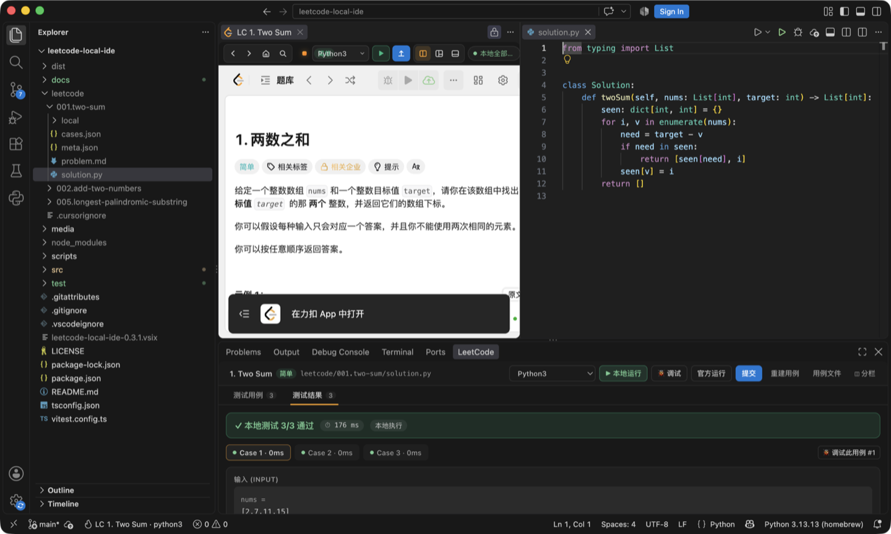
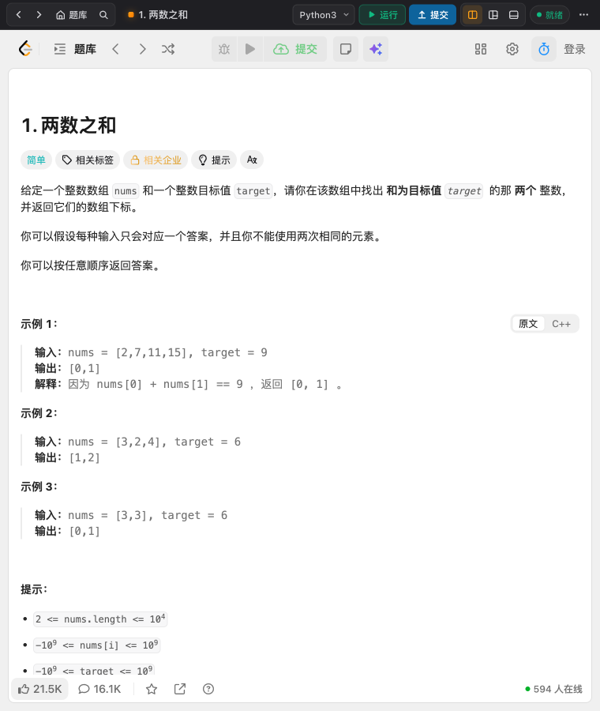
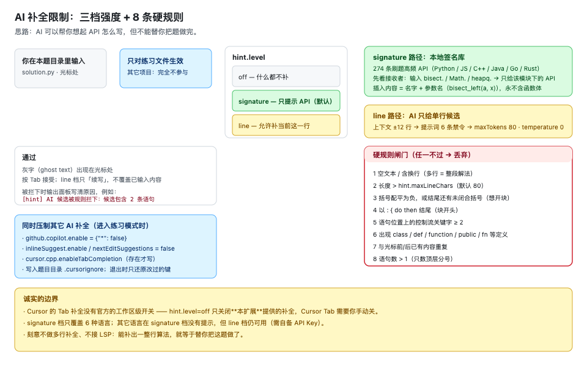
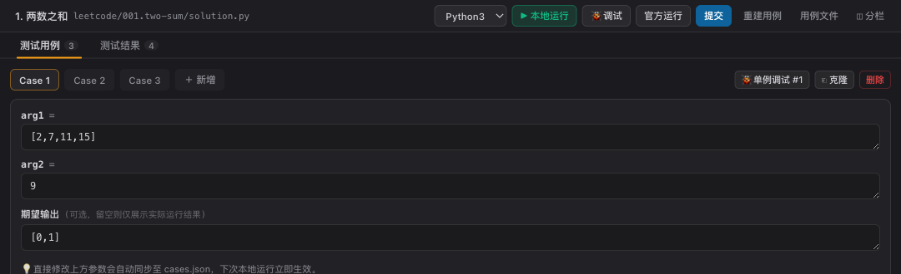
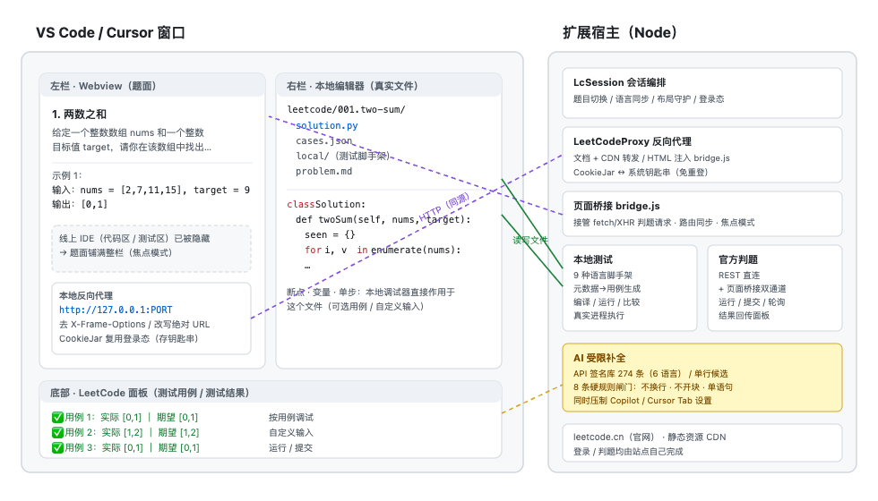

<div align="center">

# LeetCode Dojo · 刷题道场

**在 VS Code / Cursor 里一站式刷 LeetCode —— 左边题面，右边本地 IDE，底下测试台。**

本地编译 · 断点调试 · 官方判题 · 登录态持久化 —— 并把 AI 补全限制在「API 提示 / 单行」，让你在练习，而不是在抄。

[](https://code.visualstudio.com/)
[](https://cursor.com/)
[](CHANGELOG.md)
[](test/)
[](LICENSE)
[](https://github.com/captainedV/leetcode-dojo/actions/workflows/ci.yml)
[](CONTRIBUTING.md)



<sub>真实截图：左栏只剩题面（线上 IDE 已自动隐藏）· 右栏是本地 <code>solution.py</code>（可断点调试）· 底部面板显示「本地测试 3/3 通过」</sub>

</div>

---

<details>
<summary><b>English TL;DR</b> (click to expand)</summary>

**LeetCode Dojo** is a VS Code / Cursor extension for practising LeetCode *locally*.

- **Left pane**: the real `leetcode.cn` page inside a locally reverse-proxied webview — log in there, and the online editor is hidden automatically so the statement fills the pane.
- **Right pane**: a real local file (`solution.py`, `Solution.java`, …) seeded with the official class skeleton and kept in sync with the selected language. Compile, break-point and debug it with your normal toolchain.
- **Bottom panel**: test cases and per-case results; run locally (real processes, 9 languages), run/submit on LeetCode (official judge), and debug a single case with custom input.
- **AI restraint**: completions are limited to (a) a bundled DB of 274 API signatures, or (b) a *single line* candidate that must pass 8 hard textual rules. Copilot / Cursor Tab are suppressed while in practice mode.

Docs are in Chinese; code, tests and commits are English-friendly. See [`docs/verification`](docs/verification) for the measured evidence behind each claim.

</details>

<details>
<summary><b>目录</b></summary>

- [✨ 两个核心亮点](#-两个核心亮点)
- [功能一览](#功能一览)
- [截图](#截图)
- [安装](#安装)
- [快速上手](#快速上手)
- [使用指南](#使用指南)
- [AI 补全限制（详解）](#ai-补全限制详解)
- [配置项](#配置项)
- [工作原理](#工作原理)
- [兼容性与验证状态](#兼容性与验证状态)
- [常见问题](#常见问题)
- [路线图](#路线图)
- [开发](#开发)
- [致谢与免责声明](#致谢与免责声明)

</details>

---

## ✨ 两个核心亮点

### 亮点一：IDE 内一站式本地刷题（本地编译 + 断点调试）

不用在浏览器和编辑器之间来回复制粘贴 —— 题面、编辑器、测试台在同一个窗口里，而你写的是**真实的本地文件**。

| 你得到什么 | 实现方式 |
|---|---|
| 左栏是**真的** LeetCode 页面 | 本地反向代理 `127.0.0.1:PORT` → `leetcode.cn`，去掉 `X-Frame-Options` / CSP，改写页面里的绝对地址防止跳出 |
| 在栏内直接登录，**不用每次重登** | Cookie 双向同步到本地 CookieJar，持久化在**系统钥匙串**；代理端口固定复用，站点 localStorage 也跟着保留 |
| 只留题面，不被线上 IDE 干扰 | **焦点模式**：自动隐藏页面的「代码 / 测试用例」面板，并把题面拉到 100% 宽高 |
| 右栏是**真实文件**，可编译可调试 | 按题目落盘 `leetcode/001.two-sum/solution.py`，写入官方类框架；断点、变量、单步都是本地调试器 |
| 测试结果就在下方 | 底部面板「测试用例 / 测试结果」，可**按用例调试**、可**自定义输入** |
| 提交走**官方判题** | 双通道：REST 直连（`interpret_solution` / `submit` / `check`）+ 页面桥接（改包 `fetch` / `XHR` 替换代码与语言） |
| 自动分栏不会被打乱 | `setEditorLayout` 设两栏 + **布局守护**：左栏一旦出现普通文件就自动搬回右栏，分栏被拖掉会自动补回 |

<div align="center">
 
</div>

### 亮点二：AI 补全限制（练习优先）

直接让 AI 写完整题，练习就失去意义；完全不给提示，在 vibe coding 时代又常常记不住 API 细节。所以做成**分级 + 硬约束**：

```
off ────────► 完全不补
signature ──► 只提示「你正在调用的那个 API」的签名（默认，274 条刷题高频 API）
line ───────► 允许补当前这一行，但必须先过 8 条硬规则闸门
```



- **提示词层**：6 条禁令（不换行 / 不解释 / 不围栏 / ≤120 字符 / 不复述已写内容 / 禁止生成循环分支与函数定义）
- **参数层**：`maxTokens: 80`、`temperature: 0` —— 结构上就不允许长篇输出
- **规则层**：8 条**纯文本**硬规则（空或多行、超长、括号未闭合、以 `:`/`{` 结尾、控制流 ≥2、出现函数定义、与已有内容重复、语句数 >1），任一不过直接丢弃
- **生态层**：进入练习模式时压制 `github.copilot.*` 与已知的 `cursor.*` 设置，写 `.cursorignore`；退出时**只还原自己改过的键**

> 诚实边界：Cursor 的 Tab 补全没有官方工作区级开关，`hint.level=off` 只关闭**本扩展**的补全。详见 [AI 补全限制（详解）](#ai-补全限制详解)。

---

## 功能一览

| 能力 | 状态 | 说明 |
|---|:--:|---|
| 内嵌 LeetCode 网页 + 栏内登录 | ✅ | `leetcode.cn`（`leetcode.com` 受 Cloudflare 限制，退化为 API 模式） |
| 登录态持久化 | ✅ | 系统钥匙串；重开 IDE 免登录，自动回到上次那道题 |
| 焦点模式（只显示题面） | ✅ | 一键切换「只显示题面 / 显示完整网页」 |
| 自动左右分栏 + 布局守护 | ✅ | 左题面 / 右代码 / 底测试台，被打乱会自动归位 |
| 官方类框架同步 + 语言切换 | ✅ | 20 种语言可选；切换语言自动切 / 建对应文件 |
| 本地测试（真实进程执行） | ✅ | Python / C / C++ / Java / JavaScript / TypeScript / Go / Rust / Ruby |
| 按用例调试 / 自定义输入 | ✅ | 只把选中的用例写进脚手架，断点不会被别的用例先命中 |
| 断点调试 | ✅ | 调试器类型自动探测并降级（见下表） |
| 官方运行 / 提交 | ✅ | 结果显示在底部面板 |
| 分级提示（不给代码） | ✅ | `api` / `nudge` / `approach` 三档 |
| AI 生成测试脚手架 | ✅ | 设计类 / 特殊输入时兜底（严格 JSON + 路径与命令白名单校验） |
| 学习计划等入口进题 | ✅ | 接管 `window.open`：同站链接在面板内跳转，站外链接交给系统浏览器 |

**本地调试需要的调试器扩展**（都不是内置的，缺了会给出可操作的安装提示）：

| 语言 | 扩展 | 调试器类型（按顺序尝试） |
|---|---|---|
| Python | `ms-python.debugpy` 或 `ms-python.python` | `debugpy` → `python` |
| JavaScript / TypeScript | 内置 js-debug | `node` → `pwa-node` |
| C / C++ | `ms-vscode.cpptools` 或 `vadimcn.vscode-lldb` | `cppdbg` → `lldb` |
| Rust | `vadimcn.vscode-lldb` | `lldb` |
| Java | `redhat.java` | `java` |
| Go | `golang.go` | `go` |
| Ruby | `shopify.ruby-lsp` | `rdbg` |

---

## 截图

<table>
<tr>
<td width="50%"><br/><sub><b>完整界面</b>：左题面 / 右代码 / 底部测试结果（真实截图）</sub></td>
<td width="50%"><br/><sub><b>左栏</b>：焦点模式下只剩题面，线上 IDE 自动隐藏</sub></td>
</tr>
<tr>
<td><br/><sub><b>测试用例</b>：来自官方示例输入 + 题面输出解析，可手改 <code>cases.json</code></sub></td>
<td><br/><sub><b>测试结果</b>：逐用例实际 / 期望、耗时、stdout，失败自动展开</sub></td>
</tr>
</table>

---

## 安装

### 环境要求

| 项目 | 要求 | 说明 |
|---|---|---|
| 编辑器 | **VS Code ≥ 1.90** 或 **Cursor** | 两者都实测通过（VS Code 1.138 / Cursor 1.128） |
| 操作系统 | macOS / Linux / Windows | 截图与验证在 macOS（arm64）完成 |
| Node.js | 仅**从源码构建**时需要（≥ 20） | 安装 vsix 不需要 |
| 网络 | 能访问 `leetcode.cn` | 代码只在本地与目标站点之间流动 |

**按语言准备本地工具链**（只影响「本地运行 / 调试」，官方判题不受影响）：

| 语言 | 需要准备 | 一键安装（macOS） |
|---|---|---|
| Python 3 | **推荐 Python ≥ 3.10**（LeetCode 新模板会用 `ListNode \| None`） | `brew install python` |
| C / C++ | `clang` / `gcc`（或 Xcode Command Line Tools） | `xcode-select --install` |
| Java | JDK 17+ | `brew install openjdk` |
| JavaScript / TypeScript | Node.js ≥ 20 | `brew install node` |
| Go | Go 1.20+ | `brew install go` |
| Rust | rustc | `curl --proto '=https' --tlsv1.2 -sSf https://sh.rustup.rs \| sh` |
| Ruby | ruby | macOS 自带 `/usr/bin/ruby` |

### 方式 A：安装 vsix（推荐）

```bash
# VS Code
code --install-extension leetcode-local-ide-0.4.0.vsix --force

# Cursor
cursor --install-extension leetcode-local-ide-0.4.0.vsix --force
```

> 也可以在编辑器里：`扩展` 面板 → 右上 `…` → `从 VSIX 安装…`。
> 扩展 ID 是 `xialc.leetcode-local-ide`（历史原因保留），显示名为 **LeetCode Dojo**。

### 方式 B：从源码构建

```bash
git clone https://github.com/captainedV/leetcode-dojo.git
cd leetcode-dojo
npm ci
npm run package          # 产出 leetcode-local-ide-0.4.0.vsix
code --install-extension leetcode-local-ide-0.4.0.vsix --force
```

### 让 IDE 能在题目目录里调用到你的工具链（重要）

GUI 启动的 VS Code / Cursor 常常拿不到你 shell 里的 `PATH`（Homebrew、nvm、pyenv 都不在），表现为"找不到命令"。本插件按四级顺序解析可执行文件：

```
进程 PATH → 登录 shell 的 PATH（bash -lc）→ 常见安装目录（Homebrew、/usr/local、~/.pyenv/shims、~/.cargo/bin …）→ 缓存
```

进入题目后执行一次 **`LeetCode Dojo: 显示诊断信息`**，会打印：

```
langToolchain(python3)=齐全        # 缺什么会直接写出来，并给出安装命令
debuggers(python3)=debugpy         # 当前可用的调试器类型
layout=#1(col1,激活)=[题面] | #2(col2)=solution.py
```

如果自动挑选的 Python 版本不合适（例如系统只有 3.9），用设置项显式指定：

```jsonc
// settings.json
{
  "lcLocal.python.path": "/opt/homebrew/bin/python3.13"
}
```

---

## 快速上手

1. 点状态栏 **`LeetCode`**（或命令面板 `LeetCode Dojo: 进入 LeetCode 模式`）。
2. 左栏加载 LeetCode 题库 —— **在左栏里直接登录**（登录态会保存，下次打开免登录）。
3. 点进任意题目（题库、**学习计划**、每日一题、竞赛题单都行）：右栏自动创建并打开本地文件，左栏只剩题面。
4. 写代码，`⌘/Ctrl+S` 保存即同步到网页；网页自己的「运行 / 提交」也会用你本地的代码。
5. 用底部面板或快捷键：**本地运行** / **调试** / **官方运行** / **提交**。

| 快捷键（macOS） | 作用 |
|---|---|
| `⌘⌥Enter` | 本地运行测试 |
| `⌘⌥S` | 提交到 LeetCode |
| `⌘⌥H` | 获取提示（不直接给答案） |

---

## 使用指南

<details>
<summary><b>切换到别的语言</b></summary>

用左栏工具栏或底部面板的**语言下拉框**切换。会自动：

- 用该语言的官方模板创建 / 打开对应文件（`solution.py` / `Solution.java` / `solution.cpp` …）
- 把"当前语言"注入到官方运行 / 提交请求里

</details>

<details>
<summary><b>本地测试：用例从哪来</b></summary>

1. **官方元数据**：GraphQL 的 `metaData`（函数名、每个参数名与类型、返回类型）+ `codeSnippets`（官方模板）+ `exampleTestcases`（官方判题机用的示例输入）
2. **期望输出**：从题面 HTML 解析 `Input/Output/输入/输出`（兼容 `<pre>` 与 `<p><code>` 两种写法），按**输入内容**匹配，避免题面顺序错位
3. **生成脚手架**：只在 `local/` 下生成测试驱动，**绝不修改你的代码文件**；统一 `__LC_RESULT__` 协议
4. **比较策略**：先严格比较；严格不等时再做**乱序等价**比较（多解题目如两数之和、三数之和、全排列、异位词分组），命中会标注「内容一致但顺序不同」
5. **AI 兜底**：设计类题目或特殊输入，可用自己的 API Key 让 AI 生成脚手架（输出经文件名 / 命令白名单校验）

用例可以在 `leetcode/<题号>.<slug>/cases.json` 里手改（加自己的边界用例）。

</details>

<details>
<summary><b>调试：选用例 / 自定义输入</b></summary>

点「调试」会先让你选：`全部用例` / `某个用例` / `自定义输入…`

- 自定义输入支持 `l1 = [2,4,3], l2 = [5,6,4]`、每行一个参数、顶层逗号三种写法
- 底部面板「测试用例」每个用例右侧有 `调试` 按钮，点它只跑那一个用例
- 只调试单个用例时会带 `--raise-on-error`：**异常照常抛出，调试器会停在出错那一行**
- Python 用**标准 `import`** 加载你的文件（`typing` / `ListNode` / `TreeNode` 注入 `builtins`），你的文件一行都不用改，断点稳定命中
- 编译类语言调试时自动加调试信息：C/C++ `-g -O0`、Rust `-g -C opt-level=0`、Java `-g`、Go `-gcflags=all=-N -l`

</details>

<details>
<summary><b>官方运行 / 提交，结果在哪看</b></summary>

- 底部面板会自动打开并切到「测试结果」；失败时同时打开输出面板，并在弹窗里给出首个失败用例
- 面板被关掉：工具栏 `面板` 按钮、编辑器标题栏图标，或命令 `LeetCode Dojo: 打开底部面板`
- 完整日志：`LeetCode Dojo: 显示输出面板`

</details>

<details>
<summary><b>登录态与退出登录</b></summary>

- Cookie 存**系统钥匙串**（不可用时退回 `globalStorage/*.json`）；代理端口固定复用，站点 localStorage（语言、草稿）一并保留
- 重开 IDE 会自动回到上次那道题
- 想清空：命令 `LeetCode Dojo: 退出登录`（同时让浏览器把旧 cookie 置为过期）

</details>

---

## AI 补全限制（详解）

### 三档强度

| 档位 | 行为 | 需要 API Key |
|---|---|---|
| `off` | 本扩展不提供任何补全 | 否 |
| `signature`（默认） | 只补「你正在调用的那个 API」的**名字 + 参数名**；补全列表里给出签名 / 坑 / 返回类型 / 示例 | 否 |
| `line` | 允许 AI 补**当前这一行**，必须通过 8 条硬规则；没有 Key 时自动退化为 `signature` | 是 |

签名库覆盖 **274 条**刷题高频 API：`python3` 56 · `javascript` 50 · `rust` 50 · `cpp` 44 · `java` 38 · `golang` 36。会识别接收者（输入 `bisect.` / `Math.` / `heapq.` / `arr.` 时只给该模块下的 API），空前缀不猜以避免刷屏。

### 8 条硬规则（纯文本判断，任一不过即丢弃）

| # | 规则 | 为什么 |
|---|---|---|
| 1 | 空文本 / 含换行 | 多行 = 整段解法 |
| 2 | 长度 > `hint.maxLineChars`（默认 80） | 一行装不下就不是"单行补全" |
| 3 | 括号配平为负，或结尾仍有未闭合括号 | 想开一个块 |
| 4 | 以 `:` `{` `do` `then` 结尾 | 块开头 |
| 5 | 语句位置上的控制流关键字 ≥ 2 | 在写逻辑分支（唯一豁免：Python 的 `a if c else b` 内联条件） |
| 6 | 出现 `class` / `def` / `function` / `public` / `fn` 等定义 | 在写函数 / 类 |
| 7 | 与光标前已写内容、或光标后已有内容重复 | 无效候选 |
| 8 | 语句数 > 1（只数顶层分号，字符串里的不算） | 只允许补一条语句 |

被拦下时输出面板会写清原因，例如 `[hint] AI 候选被规则拦下：候选包含 2 条语句（只允许补一条）`。

### 开启 / 关闭

```jsonc
{
  "lcLocal.hint.level": "signature",     // off | signature | line
  "lcLocal.hint.maxLineChars": 80,
  "lcLocal.ai.enabled": true,
  "lcLocal.ai.baseUrl": "https://api.deepseek.com/v1",   // 任意 OpenAI 兼容接口
  "lcLocal.ai.model": "deepseek-chat",
  "lcLocal.ai.apiKey": "",               // 或用环境变量 LC_LOCAL_AI_KEY
  "lcLocal.aiGuard.enabled": true        // 进入练习模式时压制 Copilot / Cursor
}
```

命令 `LeetCode Dojo: 设置 AI API Key` 会引导填写并启用；`LeetCode Dojo: 开启/关闭 AI 补全限制` 可临时切换。

> **关于 Cursor Tab**：Cursor 没有提供工作区级的 Tab 补全开关，插件无法在练习时段替它关掉。`hint.level=off` 只关闭本扩展的补全；要彻底静音请在 Cursor 设置里手动关掉 Tab，或临时停用 Copilot。

---

## 配置项

| 键 | 默认 | 说明 |
|---|---|---|
| `lcLocal.site` | `leetcode.cn` | 站点。`leetcode.com` 走 API 模式（Cloudflare 拦截文档，无法内嵌） |
| `lcLocal.hint.level` | `signature` | AI 补全强度：`off` / `signature` / `line` |
| `lcLocal.hint.maxLineChars` | `80` | `line` 档单行补全字符上限 |
| `lcLocal.ai.enabled` | `false` | 启用 AI（提示 / 行补全 / 脚手架） |
| `lcLocal.ai.baseUrl` | `https://api.deepseek.com/v1` | OpenAI 兼容接口 |
| `lcLocal.ai.model` | `deepseek-chat` | 模型名 |
| `lcLocal.ai.apiKey` | `""` | 也可用环境变量 `LC_LOCAL_AI_KEY` |
| `lcLocal.aiGuard.enabled` | `true` | 压制其它 AI 补全 |
| `lcLocal.python.path` | `""` | 指定 Python 解释器；留空则自动挑 3.10+ 中的最高版本 |
| `lcLocal.run.defaultLang` | `python3` | 进题目时的默认语言 |
| `lcLocal.run.timeoutMs` | `20000` | 本地测试超时 |
| `lcLocal.layout.autoSplit` | `true` | 自动左右分栏 |
| `lcLocal.layout.leftRatio` | `0.45` | 左栏宽度比例 |
| `lcLocal.layout.lockLeftGroup` | `true` | 尽量让新文件落在右栏 |
| `lcLocal.proxy.port` | `0` | 首次使用的代理端口，之后固定复用 |
| `lcLocal.proxy.injectBridge` | `true` | 是否注入桥接脚本（关掉即退化为普通浏览器） |
| `lcLocal.editor.hideSiteEditor` | `true` | 焦点模式：隐藏线上 IDE |
| `lcLocal.workspace.subdir` | `leetcode` | 题目目录名（相对工作区根） |

---

## 工作原理



几个关键实现（都是实测撞出来的，详见 [`docs/verification`](docs/verification)）：

1. **必须代理 CDN 并改写文本**：站点用绝对地址 `https://leetcode.cn/...` 做路由跳转，不改写的话 iframe 会整页跳到真实站点、桥接直接失效。所以 `static.leetcode.cn` 的 JS/CSS 也经代理，并把 `https://leetcode.cn` 改写为代理源。
2. **焦点模式要压 FlexLayout**：站点面板是绝对定位的 FlexLayout，只 `display:none` 会留白；必须同时把题面 tabset 拉到 100% 宽高，且**只在 `/problems/<slug>/` 生效**（避免误伤题库 / 学习计划列表）。
3. **接管判题靠改请求体**，不靠点按钮：拦截 `POST /problems/{slug}/(interpret_solution|submit)/`（含 GraphQL 变体），替换 `typed_code` / `lang`，其余字段原样保留。
4. **`window.open` 必须接管**：学习计划里的题目行不是链接，而是 `window.open()`；webview iframe 里 popup 会被拦，表现就是"点了没反应"。
5. **布局守护的坑**：`TabInputWebview.viewType` 实际带 `mainThreadWebview-` 前缀，且 `workbench.action.lockEditorGroup` 在 VS Code 1.138 / Cursor 1.128 里不生效 —— 所以改成「监听 `tabGroups` + 把左栏普通文件搬回右栏」。
6. **Python 调试必须走标准 import**：`exec(compile(...))` 加载的代码对象在部分调试器下不绑断点；调试入口改成 `importlib.import_module`，并把 `typing` / `ListNode` / `TreeNode` 注入 `builtins`（不修改你的文件）。

---

## 兼容性与验证状态

**已实测**

- **299 个自动化测试**（`npm test`）：题面解析、代理改写规则、判题请求识别 / 改写、9 种语言脚手架的**真实编译执行**（Python 3.9 / 3.13、Node 25、Apple clang 17、Ruby 2.6 真跑；Java / Go / Rust 因本机无工具链只做结构断言并 skip）、AI 提示词与脚手架输出校验、8 条硬规则、布局与 viewType 回归
- **端到端集成测试**（真实访问 `leetcode.cn`）：激活 → 起代理 → 建面板 → 路由 → 建文件 → 推送代码 → 本地 Python **3/3 通过** → 切 C++ → 本地编译 **3/3 通过** → 调试降级链路 → 底部面板驱动 → 退出
- **真实宿主验证**（VS Code 1.138 / Cursor 1.128，隔离 profile + 自检探针）：真实 `tabGroups` 状态为「左栏题面 / 右栏 `solution.py`」，人为把文件开到左栏后**自动搬回右栏**

**尚未验证（需要你的环境 / 账号）**

- 真实**登录 + 提交**的完整链路（无账号凭据；端点与请求体已按站点前端产物核对，桥接与 REST 直连两条通道都实现）
- Java / Go / Rust 脚手架的**真实编译运行**（本机无 JDK / go / rustc）
- `leetcode.com` 的内嵌（Cloudflare 固定拦截，只支持 API 模式）
- Windows 上的完整回归（代码已做跨平台处理，但未实测）

---

## 常见问题

<details>
<summary><b>左栏空白 / 一直转圈</b></summary>

看 `输出 → LeetCode Dojo`。若是 Cloudflare 人机验证，说明你用的是 `leetcode.com`，把 `lcLocal.site` 切回 `leetcode.cn`。

</details>

<details>
<summary><b>底部面板看不到</b></summary>

进入模式时插件会自动打开；若被关掉，点左栏 `面板` 按钮或执行 `LeetCode Dojo: 打开底部面板`。个别发行版会隐藏扩展面板容器，先执行一次 `查看 → 面板` 展开面板区。

</details>

<details>
<summary><b>点调试提示"配置的类型 debugpy 不受支持"</b></summary>

`debugpy` 由 `ms-python.debugpy` 提供，Cursor 默认没装。插件会提示缺少哪个扩展，并给 `搜索扩展` / `改为本地运行` 两个按钮（不会直接抛原始错误）。装一个 Python Debugger 即可。

</details>

<details>
<summary><b>报 TypeError: unsupported operand type(s) for |</b></summary>

你的代码用了 `ListNode | None`（PEP 604），需要 Python ≥ 3.10，而系统 `python3` 可能是 3.9。插件会自动挑最高的 3.10+ 解释器；若本机只有 3.9，也可以用设置 `lcLocal.python.path` 指定。另外注入的 `ListNode` / `TreeNode` 自带兼容 metaclass，`ListNode | None` 在 3.9 上同样可用。

</details>

<details>
<summary><b>提示"找不到命令 node / python3"</b></summary>

GUI 启动的编辑器 `PATH` 通常不含 Homebrew / nvm。插件会按「进程 PATH → 登录 shell → 常见安装目录」解析，仍找不到时提示里会直接给安装命令。装好后重开窗口。

</details>

<details>
<summary><b>学习计划里点题目没反应</b></summary>

已在 0.2.6 修复（题目行是 `window.open` 弹窗，webview 里会被拦 → 改为面板内跳转）。若仍异常，请附上 `LeetCode Dojo: 显示诊断信息` 的输出。

</details>

<details>
<summary><b>分栏被打乱了</b></summary>

执行 `LeetCode Dojo: 重置左右分栏布局`。平时有「布局守护」：左栏出现普通文件会自动搬回右栏。

</details>

<details>
<summary><b>本地没通过，但 LeetCode 上是 Accepted</b></summary>

多半是多解题目（顺序不同），结果里会标注「内容一致但顺序不同」。如果差异真实存在，把输出面板里的实际 / 期望贴到 issue。

</details>

---

## 路线图

- [ ] 设计类题目（LRU / MedianFinder）的本地脚手架
- [ ] 当前行 → 相关 API 提示的上下文联动
- [ ] 多显示器 / 多根工作区的布局策略细化
- [ ] Windows 全量回归 + CI 矩阵
- [ ] 发布到 VS Code Marketplace / Open VSX

想法欢迎开 issue；PR 请先看 [`CONTRIBUTING.md`](CONTRIBUTING.md)。

---

## 开发

```bash
npm ci
npm run build        # esbuild 打包扩展 + webview + 注入脚本
npm run watch        # 监听重建
npm run typecheck    # tsc --noEmit
npm test             # 299 个测试
npm run package      # 产出 vsix
```

调试扩展本身：`npm run build` 后执行 `code --extensionDevelopmentPath=.`。

界面截图素材：`npx vitest run test/docs/uiSnapshot.test.ts` 会把现有 UI 的 HTML 导出到临时目录，便于用真实 Chromium 重新截图（保证 README 素材与代码同源）。

---

## 致谢与免责声明

- 灵感来自 `vscode-leetcode`、`leetcode-cli` 等前辈，以及"在本地复刻评测机 preamble"的各类刷题模板；AI 限制思路参考了 inline suggestion 的单行补全与 LeetCode 官方 Hint 分级。
- 本项目**不是** LeetCode / 力扣官方产品。请遵守目标站点的服务条款，仅用于**个人练习**。
- 登录态与代码只存在本机；只有你主动点「官方运行 / 提交」时代码才会发往 LeetCode；只有你主动使用 AI 功能时，题目与代码才会发给你自己配置的服务商。

## License

[MIT](LICENSE) © 2026 captainedV
